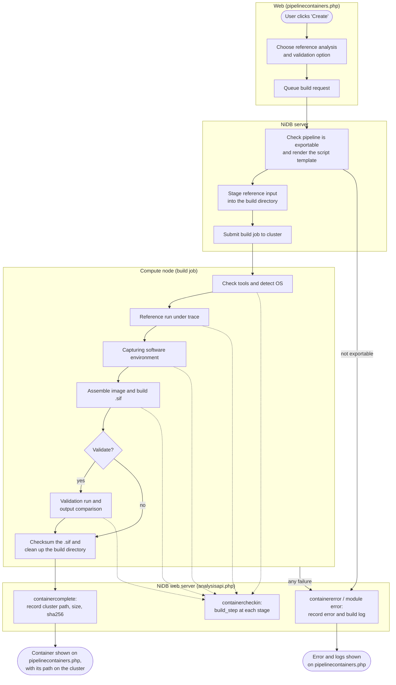

# Exporting a pipeline as an Apptainer container

Design notes for exporting a NiDB pipeline as a standalone Apptainer (`.sif`) image that anyone can run without NiDB. Written 2026-10-05, decisions in §11. **Status (2026-10-13):** the web UI (`pipelinecontainers.php`) and the `pipeline_containers` table are implemented. The backend (`modulePipelineContainer`) is partly implemented: see §9.

Companion docs: `doc/pipeline-execution.md` (how a pipeline runs today), `doc/analysis-api.md` (the check-in API that the container will *not* use).

---

## 1. Goal

The container is a portable version of an established level-1 pipeline, for people who don't have NiDB. One version of a pipeline (a row in `pipelines` plus its `pipeline_steps` and `pipeline_data_def` rows) becomes one generic image, which is run once per subject/study:

```
apptainer run --bind /data/sub01:/input --bind /results/sub01:/output mypipeline-v3.sif \
    --subjectuid S1234ABC --studynum 2 --studydatetime "2024-03-01 10:15:00"
```

The image contains four things:

| Item | Path in image | Notes |
|---|---|---|
| Input directory | `/input` | Empty mount point. The caller binds their data here; no data is baked into the image. See §6 for the expected layout. |
| Main script | `/pipeline/run.sh` + `/pipeline/run.sh.template` | The pipeline's main script steps, rendered from the NiDB definition. See §3–§4. |
| Software | same paths as on the compute node (`/opt/fsl`, `/usr/bin/R`, ...) | Captured from the compute node where the pipeline runs today. See §7. |
| Output directory | `/output` | Empty mount point. The caller binds a writable directory here. |

Plus a small, non-executed `/pipeline/manifest.json` (§6) describing the pipeline, variables, and input layout, so the image documents itself.

**Not in the image:** `nidb cluster` check-ins, `nidbapi`, step log redirection, supplement steps, the result script, the `useTmpDir` copy, `chmod 777`, scheduler headers, the API token, or anything else that is NiDB-specific or talks to the NiDB database or web server.

Only level-1 (subject/study level) pipelines can be exported. Export refuses level-0 (deprecated) and level-2 (group) pipelines.

---

## 2. What changes compared to the NiDB job file

`CreateClusterJobFile()` (`modulePipeline.cpp:2072`) builds the job script. The container script keeps only the main step commands and drops everything else:

| Job file element | Container |
|---|---|
| `#SBATCH` / `#$` headers, `LD_LIBRARY_PATH` | Dropped. The caller schedules the container however they like. |
| `NIDB_*` exports, `nidbapi()` function | Dropped |
| `nidb cluster -u pipelinecheckin ...` lines | Dropped |
| `cd <analysispath>` | `cd /output` |
| `useTmpDir` copy in/out | Dropped. The caller can bind a scratch directory as `/output` if they want local disk. |
| Step check-in + `echo Running ...` | Replaced with a plain `echo '== Step N: <description>'` to stdout. The description is shell-quoted, with flags removed and newlines flattened. |
| `{NOLOG}`, `{NOCHECKIN}`, `{PROFILE}` flags | Stripped from the command and description. `PROFILE` is not honored, and an enabled step that uses it gets a warning. |
| `>> <analysispath>/pipeline/StepN` log redirect | Dropped. Output goes to the container's stdout/stderr. |
| `cd <workingdir>` | Kept, after its variables are rendered (see §4 note about `workingdir`) |
| Disabled steps (`# command`) | Kept as comments, so the script still matches the NiDB step numbering |
| Supplement steps | Not exported. Supplements exist to augment an existing NiDB analysis during testing; the container runs a finished pipeline once. |
| Result script (`pipeline_resultsscript`) | Dropped. It exists to insert results into NiDB. |
| `updateanalysis` / `setcomplete` / final `chmod` | Dropped |

### In-place working directory

NiDB pipelines run *inside* the analysis directory: the data is downloaded into `<analysisroot>`, and steps write their outputs next to it, referring to everything as `{analysisrootdir}/...`. Existing scripts depend on that, so the container keeps the same model:

1. `run.sh` copies `/input/.` to `/output/` (`cp -a`).
2. `cd /output`.
3. `{analysisrootdir}` is `/output`.

So `/output` ends up looking like a NiDB analysis directory after the pipeline has run.

---

## 3. Pipeline variables

These are all the substitutions `FormatCommand()` (`modulePipeline.cpp:2008`) performs today, and what each becomes in the container.

**Export time** means NiDB replaces the token while building the image. **Runtime** means `run.sh` replaces it at startup.

| Variable | NiDB value | Container treatment |
|---|---|---|
| `{analysisrootdir}` | `<analysisroot>/...` path on shared storage | **Runtime:** always `/output` in the container. Kept as a token in the template (not baked in) so the build's trace run (§7) can render the same template to a scratch directory on the compute node. |
| `{pipelinename}` | `pipelines.pipeline_name` | **Export time:** constant |
| `{workingdir}` | The step's `ps_workingdir` | **Export time:** that step's working directory, rendered |
| `{description}` | The step's `ps_description` | **Export time:** constant, per step |
| `{subjectuid}` | Subject UID | **Runtime:** `--subjectuid` (required if used) |
| `{studynum}` | Study number | **Runtime:** `--studynum` (required if used) |
| `{uidstudynum}` | UID + studynum, concatenated | Converted to `{subjectuid}{studynum}` at export |
| `{studydatetime}` | `yyyy-MM-dd hh:mm:ss` | **Runtime:** `--studydatetime` (required if used) |
| `{analysisid}` | `analysis.analysis_id` | Not meaningful without NiDB, and not a runtime parameter. **Export time:** replaced with `0`, with a warning. `0` rather than an empty string, so a path like `/tmp/{analysisid}` can't collapse to `/tmp/`. |
| `{groups}`, `{uidstudynums}`, `{uidstudynums_<group>}`, `{numsubjects}`, `{numsubjects_<group>}` | Group-level, from live DB queries | Only meaningful for level-2 pipelines, which can't be exported. If one appears in a level-1 pipeline, export fails with an error naming the step. |
| `{NOLOG}`, `{NOCHECKIN}`, `{PROFILE}` | Flags | **Export time:** removed |
| `{command}` | Deprecated. Removed from the command by `FormatCommand()`, and flagged as a warning in the pipeline checks | **Export time:** removed, with a warning |
| `{first_*_file}` etc. | Already deprecated, not expanded | **Export time:** error |

So an exported pipeline needs at most three runtime values: `subjectuid`, `studynum`, `studydatetime`. The manifest records which ones the script uses, and `run.sh` only requires those.

Any other `{...}` token left after export is an error. This catches typos that NiDB silently leaves alone today.

---

## 4. How the substitution works

### Text rendering at startup (same semantics as NiDB)

The image stores `run.sh.template`, with the runtime tokens still in their `{...}` form. At startup, `run.sh` replaces them with the argument values, writes the result to a temporary file, and runs it with `bash`. This is what NiDB does today (plain text replacement before bash ever sees the script), so a command behaves identically in both places, including inside single quotes, quoted heredocs, `awk` programs, and generated filenames.

### Details

- **Case.** `FormatCommand()` matches case-insensitively (`{SubjectUID}` works). At export, NiDB rewrites every recognized token to lowercase with a `QRegularExpression::CaseInsensitiveOption` pass. That way the bash renderer only needs exact matches.
- **Substitution in bash.** `run.sh` uses `line=${line//"{subjectuid}"/$SUBJECTUID}`, with the pattern quoted. bash 5.2 has `patsub_replacement` enabled by default, where `&` in the replacement means "the matched text," so `run.sh` turns it off with `shopt -u patsub_replacement` (bash 4.2 doesn't have the option, and the `shopt` error is discarded). The validated values can't contain `&` anyway. The replacement is a plain variable in an assignment, so it isn't word-split or globbed.
- **Validation (required).** Rendered values become shell code, so `run.sh` must reject bad input before it renders anything:
  - `subjectuid` must match `^[A-Za-z0-9_-]+$`;
  - `studynum` must match `^[0-9]+$`;
  - `studydatetime` must match `^[0-9]{4}-[0-9]{2}-[0-9]{2} [0-9]{2}:[0-9]{2}:[0-9]{2}$`.

  In NiDB these values come from the database. In the container they come from whoever runs it.
- **Error handling.** The NiDB job file doesn't use `set -e`: a failing step doesn't stop later steps. The container keeps that by default, so results match, and `--stop-on-error` turns on `set -e`. `run.sh` exits with the status of the last step.
- **`workingdir`.** NiDB writes `cd <workingdir>` *without* passing it through `FormatCommand()` (`modulePipeline.cpp:2284`), so a working directory of `{analysisrootdir}/fsl` currently `cd`s to a literal `{analysisrootdir}/fsl`. Export should render it. This is also worth fixing in the NiDB job file itself.

### Example

Pipeline step 2 in NiDB:

```
cd {analysisrootdir}; bet T1/{SubjectUID}_t1.nii.gz T1/brain {NOLOG}   # Skull strip
```

`run.sh.template` after export:

```bash
# Step 2: Skull strip
echo '== Step 2: Skull strip'
cd {analysisrootdir}; bet T1/{subjectuid}_t1.nii.gz T1/brain
```

`RenderScriptTemplate()` writes each enabled step as the comment, the echo, `cd <workingdir>` (if the step has one) and the command, with a trailing `;` removed as `FormatCommand()` does. A disabled step is written as a `# Step N (disabled):` comment followed by its commented-out lines. Variables are replaced in one pass over the text, so values inserted for `{workingdir}` and `{description}` aren't scanned again. After rendering, any `{word}` other than the four runtime tokens in a line that runs is an error. `requiredVariables` lists the runtime variables that appear in the lines that run, and is written to `manifest.json` and `requiredvars.txt` (one per line).

Rendered at runtime with `--subjectuid S1234ABC`:

```bash
cd /output; bet T1/S1234ABC_t1.nii.gz T1/brain
```

### `run.sh` (fixed, same for every pipeline)

```
usage: run.sh [--subjectuid UID] [--studynum N] [--studydatetime "YYYY-MM-DD hh:mm:ss"] [--stop-on-error] [--help]
```

1. Parse the arguments, and check them against the validation rules above.
2. Check that every variable in `/pipeline/requiredvars.txt` was given.
3. Check that `/output` exists and is writable. Its path becomes `{analysisrootdir}` and is inserted as text, so it may only contain letters, numbers and `_ . + / -`.
4. If `/input` isn't empty, `cp -a /input/. /output/`.
5. Render `/pipeline/run.sh.template` into a `mktemp` file in `$TMPDIR` (default `/tmp`), deleted on exit. A variable that wasn't given is left as it is; since `requiredvars.txt` covers every line that runs, those can only be in comments and echo lines.
6. `cd /output` and run the rendered script with `bash` (`bash -e` with `--stop-on-error`), then exit with its status.

`--help` prints the usage and `/pipeline/README.txt`. `run.sh`'s own errors exit with status 2.

`run.sh` is the same for every image, so the per-pipeline output is only the template and the manifest. It's embedded in `modulePipelineContainer.cpp` and written into the build directory by `WriteRunScript()`, like `build-container.sh`, so there's no extra file to install with NiDB. It must work with bash 4.2 (CentOS 7) and avoid tools that may be missing from a minimal base image (no `jq`: the build writes `requiredVariables` into a plain-text file next to the manifest). For the reference run (§7 step 1), which runs `run.sh` on the node outside a container, `run.sh` reads `NIDB_PIPELINE_DIR`, `NIDB_INPUT_DIR` and `NIDB_OUTPUT_DIR` in place of `/pipeline`, `/input` and `/output`. `NIDB_*` variables are never copied into the image's environment.

---

## 5. Absolute paths in step commands

Step commands often contain absolute paths. Most are handled automatically by the trace (§7), which captures whatever the pipeline touched. Two kinds are checked at export, before anything runs:

| Kind | Example | Handling |
|---|---|---|
| The pipeline's own analysis root | `/nidb/data/analysis/S1234ABC/2/mypipe/...` written literally instead of `{analysisrootdir}` | Error: the user must change the step to use `{analysisrootdir}` |
| NiDB archive or other pipelines' analysis dirs | `/nidb/data/archive/...` | Error: data has to come in through `/input` |

Detection compares path-like tokens in the commands against `cfg[archivedir]`, `cfg[analysisdir]`, `cfg[analysisdirb]`, and the `analysisdirs` table.

---

## 6. Input layout and the manifest

The container doesn't download data. The caller has to provide `/input` laid out the way `GetData()` would have staged it (`doc/pipeline-execution.md` §6):

- per enabled data step: `<pdd_location>/[<seriesnum>/][<phasedir>/]` holding files in `pdd_dataformat` (`dicom`, `nifti3d`, `nifti4d`, ... gzipped if `pdd_gzip`). `<seriesnum>` is the original series number if `pdd_preserveseries`, otherwise 1, 2, 3, ...; `<phasedir>` is `AP`, `PA`, `RL`, `LR`, `COL`, `ROW` or `unknownPE`;
- behavioral data, as `GetBehPath()` places it: `behroot` → `<location>`, `behrootdir` → `<location>/<behdir>`, `behseries` → `<location>/<seriesnum>`, `behseriesdir` → `<location>/<seriesnum>/<behdir>`;
- or, if `pipeline_outputbids` is set, a BIDS dataset in `<BIDSoutputDir>`, with `sub-<subjectuid>/ses-<studynum>` directories;
- if the pipeline has a parent: the parent pipeline's output in `/input/<parent pipeline name>/` (`pipeline_dependencydir` = `subdir`) or the root.

The layout is documented, not enforced or converted. The container doesn't check `/input` or rearrange data; matching the layout is the caller's job. `modulePipelineContainer::GetInputDirStructure()` generates the description from the pipeline version's data steps (`modulePipeline::GetPipelineDataDef()`), as readable text and as JSON, and it's published in four places:
- `README.txt`, in the build directory next to the `.sif`, and in the image as `/pipeline/README.txt`;
- the image's `%help`, which is `README.txt`, so `apptainer run-help <sif>` shows it;
- `manifest.json` `inputLayout`: one object per entry, with `type` (`data`, `bids` or `parent`), `location`, and for data steps `modality`, `protocols` (an array), `format`, `gzip`, `seriesDirectories`, `preserveSeriesNumbers`, `phaseDirectories`, `behavioralLocation`, `behavioralOnly`, `optional`;
- the Usage section of `pipelinecontainers.php`, which uses the same rules for the current version.

The list is per destination, not per data step. Data steps that write to the same directory with the same modality, format and notes (series and phase directories, behavioral location, optional) are one entry, listing all their protocols, since to the container they're one input. Steps that differ in any of those stay separate entries, even with the same directory.

Example `README.txt` section:

```
INPUT LAYOUT (/input)
Lay out /input as NiDB would have staged the data for this pipeline. The container doesn't check the layout.

    /input/T1/<seriesnum>
        MR, protocols [MPRAGE], [MPRAGE_repeat], format [nifti3d, gzipped]
        <seriesnum> is 1, 2, 3, ... for each matching series, in order
    /input/fmri/<seriesnum>
        MR, protocol [rest], format [nifti4d, gzipped]
        <seriesnum> is the series' original series number
        Optional
```

`/pipeline/manifest.json` is written in two parts, because only the build job knows what went into the image:
- **NiDB's part**, `manifest-export.json`, written by `CreateManifest()` when the build directory is prepared (§8 step 2):
  - this input layout (`inputLayout`);
  - the pipeline name, version, description, and the date it was exported (*to do:* the NiDB instance it was exported from);
  - `requiredVariables`;
  - the export warnings (`exportWarnings`);
  - *to do:* the full squirrel pipeline JSON, reused from `pipeline::GetSquirrelObject()`, so the image can be re-imported into a NiDB instance later.
- **The build job's part**, added by `write_manifest()` in `build-container.sh` (§8 step 4), which writes `manifest.json` as NiDB's object plus a `build` object. It runs after the software capture and before the image is assembled, so the copy inside the image is complete. The `build` object has:
  - `containerId`, `date`, `hostname`, `jobId`;
  - `os`: `id`, `versionId`, `prettyName`, `family`, `kernel`, `arch`, `glibc`;
  - `packageManager`, `baseImage`, `apptainer` (version);
  - `interpreters`: `name`, `path` and `version` of R, perl, python, java, ... found on the build node;
  - the captured software, from §7: `capturedPackages` (`name`, `version`, `arch`), `capturedOptDirectories`, `capturedPaths`, and `environment` (the image's `%environment` lines);
  - `buildWarnings`: the build's warnings up to that point.

  The validation run (§8 step 4.6) happens after the image is built, so its results aren't in the manifest. They're in `validation.txt` next to the `.sif`. Rebuilding `manifest.json` from `manifest-export.json` each time means a requeued job doesn't add a second `build` object.

`README.txt` (written by `CreateReadme()`) has the pipeline name, version and description, an example `apptainer run` command, the arguments this pipeline uses (§3), and the input layout. It's the image's `%help`, so `apptainer run-help` shows the same text, and it stays next to the `.sif` in the build directory (§8).

---

## 7. Capturing the software

Real pipelines use whatever is on the compute node: software in `/opt` installed by the sysadmin, and system software (R, perl, python, tcsh, their libraries and add-on packages) from the node's OS. NiDB has no record of which. So the build runs on a compute node where the pipeline runs today, and finds out by running the pipeline once. Discovery and build happen in one job on a compute node, in the pipeline's own queue.

### Step 1: a reference run under `strace`

The export is based on a **reference analysis**: a completed, not-bad analysis of this pipeline version, picked by the user (default: the most recent one).
- NiDB stages that study's input again into `<builddir>/input` with `StageReferenceInput()`:
  - **Data steps:** `modulePipeline::GetData()`, with the requested version's data steps, called with analysis ID `-1` so it doesn't log events or set the status on any analysis, and with `localCopy`, so it copies with `cp` even if the pipeline uses `scp`. Its data log goes to `input.log`. As in `modulePipeline`, staging fails if no series were found, unless the pipeline has a study-level parent.
  - **Parent pipeline:** the first parent, as in `modulePipeline`. A study-level parent's analysis of the same study, or a subject-level parent's completed analysis nearest in time. Its directory comes from `GetAnalysisLocalPath()` with the parent's own directory structure. It's copied with `cp -au` (always a regular copy, whatever the link type) into `input/` or `input/<parent name>/`, and the parent's `pipeline/` logs, `origfiles.log`, `sge.job` and `slurm.job` are removed.
  - `GetData()` reads the pipeline's BIDS settings from the current version, not the requested one.
- The build job renders `run.sh.template` with the reference study's values and `{analysisrootdir}` set to a scratch directory, and runs it under `strace -f -e trace=file,process -o trace.log`.
- `build-container.sh` runs in a login shell, like the pipeline job (`#!/bin/bash -l`), and dumps the environment (`env.txt`, and `env.0` NUL-separated for parsing) at the start. The traced `run.sh` inherits that environment but isn't a login shell itself. Otherwise the trace would include every `/etc/profile.d` script and the commands they run, and their packages (PackageKit, flatpak, mc, ...) would be copied. In testing, this cut a small pipeline from 161 captured packages to 34.
- `reference.start` is touched just before the run. Files modified after it are the run's output, not software, and aren't captured.

This runs the pipeline once on a compute node, which takes as long as the pipeline (many hours for FreeSurfer).

### Step 2: sort what was touched

`capture_software()` in `build-container.sh` takes the first quoted absolute path of every traced call that didn't fail (`= -1`). Relative paths are skipped, since the trace doesn't record each process's working directory, and so are paths strace had to escape (`capture/trace-escaped.txt`). Each existing file (not directory) outside the build directory, `$TMPDIR`, `/proc`, `/sys`, `/dev`, `/run`, `/tmp`, `/var/tmp` and the home directory's dot files (except `~/.local`) is sorted. A symlink's target is followed one link at a time and sorted too:

| Kind | How it's found | What gets copied |
|---|---|---|
| Owned by a system package (`/usr/bin/R`, `libgomp.so.1`, perl modules from the distro) | A map of every installed file to its package, built once: `rpm -qa --qf '[%{FILENAMES}\t%{=NAME}...]'` (RHEL family, SUSE, Fedora) or `/var/lib/dpkg/info/*.list` with `dpkg-query` (Debian, Ubuntu). Much faster than `rpm -qf` per file | The whole package, at the node's installed version. Copying the whole package covers files the reference run didn't happen to touch, and pins the exact versions without needing a working package repo. The skeleton packages (`filesystem`, `setup`, `basesystem`, `base-files`, `base-passwd`, kernels) are never copied, since they'd replace the image's own `/etc/passwd` and top-level links. `capture/package-reasons.txt` records the file that pulled in each package |
| Under `/opt/<name>` | path | The whole `/opt/<name>` directory. Except when `/opt/<name>` holds several installs side by side (`/opt/fsl/fsl-5.0.11`, `/opt/fsl/fsl-6.0.3`): if every traced path under it is in one subdirectory (directly, or through a link in `/opt/<name>` like `current -> fsl-6.0.3`), no file directly in `/opt/<name>` was used, and that subdirectory is an install root itself (has `bin`, `lib` or `lib64`), only that subdirectory is captured, plus the link. A program's own `bin`, `lib`, `share` are siblings, so `/opt/<name>` is never split down to one of them (`find_opt_installs()`) |
| Language add-on libraries not owned by a package (R site library, CPAN modules, python packages installed under `/usr/local`) | path matches a known library root for the OS family (§7 "Supported OSes") | That whole library root, so any add-on package the script loads conditionally is included |
| Other unowned files (`/usr/local/bin/foo`, user scripts in `/home/...`) | everything else | The file. If its directory is named in the step commands (`run.sh.template`) and isn't a system directory or the home directory itself, the whole directory, unless it's over 2 GB (then only the files used, with a warning) |

Paths are kept as the pipeline saw them, so `/opt/x` stays `/opt/x` even if `/opt` is a link to shared storage. The one exception is the merged-`/usr` links (`/bin`, `/sbin`, `/lib`, `/lib64`, ... → `/usr/...`), which are resolved, in the traced paths and the package file map alike, so a file has one name and the staging tree never has a real `/lib64` where the base image has a link.

Not copied, without a warning: files Apptainer provides at run time or that describe the node (`/etc/passwd`, `/etc/group`, `/etc/hosts`, `/etc/resolv.conf`, `/etc/localtime`, `/etc/nsswitch.conf`, ...), `/var/log` and `/var/cache`, and `/usr/share/doc`, `man` and `info`.

If the node has neither `rpm` nor `dpkg` (or the package database is unusable), everything is treated as an unowned file. The image then gets what the trace and the `ldd` pass found. That still works, but it's less complete, and the export log says so.

Then:
- a `ldd` pass over every newly copied ELF file (checked by its magic bytes) adds any shared library the trace missed. The libraries are sorted the same way, which can bring in more packages, so this repeats until nothing new turns up (at most 8 rounds);
- the copy: every path is listed and copied into `staging/` in one `tar` pipe, keeping links and permissions. Directories reached through a link become real directories. An entry under a copied directory link is copied at its real path instead, since `tar` would extract it through the link, possibly outside `staging/`. Files the build user can't read are listed in `capture/tar-read.log`, with a warning;
- **environment** (`environment.txt`, the image's `%environment`): from `env.0`, variables whose value is a path, or path list, in the image. Path lists such as `PATH` and `LD_LIBRARY_PATH` are cut down to the entries in the staging tree or the standard system directories. Non-path values are kept only for known tool settings (`FSL*`, `FS_*`, `FREESURFER*`, `ANTS*`, `AFNI*`, `MNI_*`, `ITK_*`). Scheduler, user, session, locale, module-system and NiDB variables (`SLURM_*`, `SGE_*`, `PBS_*`, `NIDB_*`, `HOME`, `USER`, `TMPDIR`, `LANG`, `LC_*`, `BASH_ENV`, `MODULEPATH`, `LMOD*`, ...) never are. Apptainer doesn't source `/etc/profile.d` from the image, so this is needed even when the `profile.d` files are copied. Values are single-quoted, since `%environment` is run by `sh`;
- **deny list, never copied even if touched:** `/etc/shadow`, `/etc/gshadow`, `/etc/munge/`, `/etc/ssh/*_key`, `*.keytab`, `/etc/sssd/`, `.ssh/`, `.gnupg/`, `.aws/`, `.netrc`, `.pgpass`, `.my.cnf`, `nidb.cfg`, and known license files (FreeSurfer `license.txt` and `.license`, MATLAB `licenses/`). Excluded files are listed in `capture-excluded.txt`, with a warning. FreeSurfer's license must then be bound at runtime (`--bind license.txt:/opt/freesurfer/license.txt`), and the build says so;
- **warnings:** non-package binaries needing a newer glibc than the node's (see "End-of-life OS images"), MATLAB directories that aren't the Runtime (MCR), files from the home directory (Apptainer mounts the user's home over it), an end-of-life OS, and no package manager.

Every `rm -rf` in `build-container.sh` goes through `safe_rm()`, which refuses unless the build directory is an absolute path at least two levels deep, and the path is inside it and has no `.` or `..` components.

A trace only sees the code path that the reference run took. Whole-package and whole-directory copies cover most of the gap. For the rest, the pipeline's container settings (not yet implemented) allow extra paths to include and paths to exclude, saved per pipeline version and applied on every export.

### Step 3: base image

The feature is neutral about the cluster OS: any Linux distribution should work. The base is the same OS release as the compute node, read from `ID` and `VERSION_ID` in `/etc/os-release` and looked up in a mapping table in `build-container.sh` (e.g. `centos 7` → `docker://centos:7.9.2009`, `rocky 8` → `docker://rockylinux:8`, `ubuntu 22.04` → `docker://ubuntu:22.04`). The captured package files are laid over it, so the image ends up with the node's versions of everything the pipeline uses, and the base's own (possibly older) versions of everything else. No package manager runs during the build, so no repos are needed.

If the node's OS isn't in the mapping table, the build stops with an error, unless the pipeline's container settings name a base image explicitly. That override is also how to use a pre-pulled `.sif` on shared storage.

### Supported OSes

The design is distribution-neutral, but each OS family needs a few facts. A family counts as **supported** once a real pipeline has been exported from it and the image has run successfully on a different machine. The facts per family:
- package manager commands;
- base image name pattern;
- language library roots.

| OS family | Package manager | Base image | Language library roots (unowned add-ons) | Status |
|---|---|---|---|---|
| RHEL family: CentOS 7, Rocky/Alma 8–9, RHEL | `rpm -qf` / `rpm -ql` | `centos:7.9.2009`, `rockylinux:<N>`, `almalinux:<N>` (RHEL nodes: Rocky/Alma of the same major version, since the RHEL UBI images are incomplete) | `/usr/lib64/R/library`, `/usr/local/lib64/R/library`, `/usr/local/share/perl5`, `/usr/local/lib64/perl5`, `/usr/local/lib/python*/site-packages`, `/usr/local/lib64/python*/site-packages` | Untested |
| Debian / Ubuntu | `dpkg -S` / `dpkg -L` | `debian:<N>`, `ubuntu:<N>` | `/usr/local/lib/R/site-library`, `/usr/lib/R/site-library`, `/usr/local/share/perl/*`, `/usr/local/lib/x86_64-linux-gnu/perl/*`, `/usr/local/lib/python*/dist-packages` | Untested |
| SUSE (openSUSE Leap, SLES) | `rpm -qf` / `rpm -ql` | `opensuse/leap:<N>` | as RHEL family | Untested |
| Anything else | none (trace + `ldd` only) | explicit override required | none | Not supported, but may work |

The library roots are a starting point. `R_LIBS*`, `PERL5LIB` and `PYTHONPATH` from the node's login environment are added to them automatically. This table should be updated as each OS is tested, and a copy of the supported list goes into the user documentation.

### End-of-life OS images

Preserving pipelines on the OS they were built and validated on is a goal of this feature. CentOS 7 is used as the example below, but the same applies to any old release (Ubuntu 16.04/18.04, Debian 9, ...). A typical case is a pipeline that runs on CentOS 7 nodes, which will eventually be upgraded or retired. This works because only the host kernel and Apptainer itself matter at runtime, and an EL9 kernel runs a CentOS 7 userspace.

- **Export while the old nodes still exist.** Because the software is captured from the node, a CentOS 7 pipeline must be exported from a CentOS 7 node. Once the nodes are upgraded, the node's R, perl and system libraries for that pipeline are gone. Recovery then means rebuilding from the CentOS 7 archive repos (`vault.centos.org`), with `%post` package installs. That needs `--fakeroot` builds, and it doesn't reproduce the node's package versions.
- **Dead repos don't matter for the normal path.** `docker://centos:7.9.2009` can still be pulled, and since the build copies package files rather than installing them, the defunct `mirrorlist.centos.org` isn't used. Only the fallback above, or extra `%post` installs, needs the repos repointed at the vault and `ca-certificates` updated first.
- **glibc check.** CentOS 7 has glibc 2.17. Old binaries run on newer glibc, but not the reverse. Before building, the job checks the copied `/opt` and other non-package binaries with `objdump -T`. It warns about any that need a newer glibc than the base has, which happens when `/opt` holds software that was built on a newer system.
- **No security updates.** The image carries known, unpatched CVEs. For a batch container with no network services the practical risk is low, but institutional scanners and some HPC centers may flag or block such images. The export writes a warning into the export log, `README.txt` and `manifest.json`.
- **How old.** CentOS 7–era userspaces run on current kernels. CentOS 6 and older can hit kernel incompatibilities (e.g. the vsyscall issue) and are not a target.

### Pipelines that run containers

Pipelines whose steps run Apptainer, Singularity, Docker or Podman containers can't be exported. The image would need a container runtime inside a container, which generally doesn't work (no setuid inside a container, and nesting in user-namespace mode depends on the host). The capture would also be wrong: the trace records the inner container's paths, like its own `/usr/bin/python3`, which would be looked up on the node, and the `.sif` would be copied in as a large data file. Such pipelines are blocked in two places, with the same message, which suggests sharing the pipeline's existing image instead:
- **Export check** (`CheckContainers()`, called from `CheckIfExportable()`, and the matching pitfall on `pipelinecontainers.php`): an enabled main step that runs `apptainer`, `singularity`, `docker` or `podman` with a run-type subcommand (`exec`, `run`, `shell`, `instance`, `test`, `start`, `create`, `compose`, `container`), runs `docker-compose` or `run-singularity`, or names a `.sif`/`.simg` image (which can be run directly). Shell comment lines are skipped.
- **Trace check** (`check_container_use()` in `build-container.sh`, at the start of the capture): if the reference run executed `apptainer`, `singularity`, `run-singularity`, `starter`, `starter-suid`, `docker`, `docker-compose` or `podman`, the build fails. This catches containers started from a script the step calls. The error gives the container command and the program that started it, from the trace's `fork`/`execve` calls, for example `[apptainer exec /data/fmriprep.sif ...], started by [bash /home/user/scripts/run_fmriprep.sh]`.

A possible later extension: for a pipeline whose steps all run inside the same container, build from that `.sif` (`Bootstrap: localimage`) instead of a distro base image, and remove the `apptainer exec <sif>` prefix from the step commands, so nothing is nested.

### Size, licensing, and portability

- **Size.** `/opt/fsl` is ~5 GB and FreeSurfer ~10 GB, so images will be large. squashfs compression helps, and the export reports the image size.
- **Licensing.** Commercial software (MATLAB, ...) must not end up in an image meant to be shared. Beyond the license-file deny list, the export warns when it copies a known commercial install directory. Compiled MATLAB with the MCR can be included.
- **GPU / MPI.** Out of scope for a first version. `--nv` works at runtime if the software supports it.

---

## 8. Build process



1. **Trigger.** The **Create** button on `pipelinecontainers.php` (reached from the *Manage containers* tile on the pipeline's Operations tab) always builds the pipeline's current version. It's only enabled for the pipeline owner or a site admin, and only when the export checks shown on that page have no errors (level-1 pipeline, at least one completed, not-bad analysis of this version, no group/deprecated variables, NiDB storage paths or container runs in the steps; see "Web UI" below), and when no build for this version is already in progress. The user picks the reference analysis (default: the most recent) and whether to run the validation step (on by default; turning it off is useful for long pipelines). A row then goes into `pipeline_containers` with `build_status` = `submitted`, `build_createdate` = now, `reference_analysisid` and `run_validation`.
2. **Prepare (NiDB server).** The `pipelinecontainer` module (`modulePipelineContainer`, run every minute from cron like the other modules) picks up `submitted` rows and sets them to `started`. A row still `started` when the module next runs means a previous run stopped part way through, and is marked `error`. The module writes a build directory on shared storage that both the server and the compute nodes can reach, `cfg[analysisdir]/_apptainer/<pipelinecontainer_id>/` (named by ID only, so it can be found from the row alone and doesn't change if the pipeline is renamed), containing:
   - `run.sh` (fixed), `run.sh.template`, `manifest-export.json` (NiDB's part of the manifest, §6), `README.txt`, `requiredvars.txt`;
   - the build directory is removed first if it's left from an earlier attempt, so old files aren't mixed with this build's. `cfg[siteurl]` must be set, since the build job reports back through `analysisapi.php`;
   - `input/`: the reference study's input, staged again (§7 step 1), and `input.log`, the data log;
   - `export.log`: the pipeline, version, reference analysis, required arguments and the export warnings (§3, §5). Errors stop the export before this point;
   - `build-container.sh`, written by `WriteContainerBuildScript()` (see "The build script" below), then `build.job`, written by `WriteClusterJob()`: the sbatch/SGE header from the pipeline's cluster settings, then `exec /bin/bash -l build-container.sh` (no arguments; all settings are in the script). The header matches `modulePipeline`'s job files, except:
     - the job name is `<pipeline>-container`, and the scheduler output goes to the build directory;
     - the wall time is the pipeline's maximum × the number of pipeline runs (1, or 2 with validation) + 4 hours, for the capture and image build. No limit if the pipeline has none;
     - SGE jobs don't use `-V`, so the submit host's environment doesn't end up in `env.txt` and the image.
3. **Submit.** Set `build_status` = `building` (before submitting, since the job can check in as soon as it starts), then submit `build.job` with the existing `nidb::SubmitClusterJob()`, using the pipeline's own cluster and queue settings (the cluster's path to the build directory, from `GetClusterBuildDir()`). `pipeline_containers` has no job ID column, so the job ID goes in `build.jobid` in the build directory, and in `build_log` with the scheduler's output. A failed submission sets the row to `error` with the scheduler's output. This is the module's last action on the row; it doesn't poll. `build_startdate` stays empty until the job's first check-in, so a job waiting in the queue shows as *Waiting in the cluster queue*.
4. **Build (compute node)**, done by `build-container.sh`. At the start of each major step it checks in to `analysisapi.php` (`containercheckin`, see "Check-ins" below), which sets `build_step` (the step in brackets):
   1. *(`preReferenceAnalysisChecks`)* Check that the required tools are present, and fail with a message listing any that are missing. Read `/etc/os-release`, choose the base, and choose the package manager (§7 step 3).
   2. *(`runningReferenceAnalysis`)* Reference run under `strace`, plus the environment dump (§7 step 1).
   3. *(`postReferenceAnalysisChecks`)* Sort and collect the files into a staging tree, with the `ldd` pass, deny list and glibc check (§7 step 2).
   4. *(`buildingContainer`)* Write `manifest.json` (§6). `apptainer build --sandbox base/ docker://<base>`, then `chmod -R u+rwX base/` (an unprivileged sandbox keeps the image's read-only modes, e.g. on `usr/bin`, so nothing could be added to those directories), then copy the staging tree and `/pipeline/*` into `base/`.
   5. Build the `.sif` from a definition file with `Bootstrap: localimage` / `From: base/` and only `%environment`, `%runscript`, `%labels` and `%help` (no `%post`).
   6. *(`runningValidationAnalysis`)* **Validation run (optional):** `apptainer run` the new image on `input/` and compare the output file list with the reference analysis directory. NiDB's `pipeline/` logs, job files and the `completeFiles` check are excluded from the comparison. The results go to `validation.txt`.
   7. Get the `.sif`'s size and sha256, then remove the sandbox (`base/`), `staging/`, the staged `input/` (the reference subject's data), `reference/` and `validation-output/`. The `.sif`, `README.txt`, `manifest.json`, `validation.txt` and the logs stay in the build directory.
5. **Finish (from the node).** The script's `EXIT` trap reports the result, so it's reported on failure and on `SIGTERM` from the scheduler too:
   - success: `containercomplete` sets `build_status` = `complete`, `build_step` = `buildComplete`, `build_enddate`, `container_date`, `container_path` (the `.sif`'s path **as the cluster sees it**, `cfg[clusteranalysisdir]/_apptainer/<id>/<pipeline>-v<version>.sif`), `container_size` and `container_sha256`;
   - failure: `containererror` sets `build_status` = `error` and `build_enddate`, with the last line of `build-error.txt` as the message. `build_step` is left at the step where the build stopped, and the build directory is left as it is, for diagnosis.

   Either way, `build-warnings.txt` is appended to `build_warnings`, a line is added to `build_log`, and the token is cleared, so this is the job's last API call. **The `.sif` stays on the cluster disk** and isn't copied back to NiDB; `pipelinecontainers.php` shows the user where it is.

   A job killed with `SIGKILL` (or one that never starts) can't report, and its row stays `building`. *To do:* a stale-build check, e.g. comparing `build_startdate` with the wall time, or the scheduler's job state using `build.jobid`.

### Check-ins

`WriteContainerBuildScript()` creates a new random token for each build, stores its SHA-256 in `build_apitoken`, and writes the raw token, the container ID and `<cfg[siteurl]>/analysisapi.php` into the script's settings block. These are plain shell variables, not exported, so the pipeline never sees them and they don't end up in `env.txt` or the image. `analysisapi.php` only accepts a container's token while its row is `building`. A failed check-in is logged in `build.log` but doesn't stop the build; if the final `containercomplete` call fails, `build.log` says where the finished `.sif` is. The actions are described in `doc/analysis-api.md`.

Each check-in sets `build_step`, `build_step_message` (up to 255 characters) and `build_hostname`, sets `build_startdate` on the first one, and adds a line to `build_log`. They're milestones of the build, not the progress of the pipeline inside the reference or validation run.

Only `build-container.sh` runs on the node. It doesn't depend on the `nidb` binary on the cluster. It needs only:
- standard Linux tools: `bash`, coreutils, `find`, `ldd`;
- `curl`, and network access from the node to the NiDB web server (`cfg[siteurl]`), for the check-ins. Without `curl` the script stops at once, and the row stays `building`;
- the node's package manager, if there is one;
- `strace`, `objdump` (binutils) and `apptainer`, installed on the nodes for this feature (§8 "Cluster requirements").

### The build script (`build-container.sh`)

A bash script, generated per build. `modulePipelineContainer::WriteContainerBuildScript()` writes it into the build directory during step 2, before `build.job`. It has two parts:
- **Settings block, generated per build:** container ID, pipeline name and version, the build directory and reference analysis directory as the compute node sees them (`cfg[clusteranalysisdir]`; `GetAnalysisClusterPath()`), the reference study's UID, study number and date (checked against `run.sh`'s rules before writing), `RUN_VALIDATION`, the `.sif` name, and a base image override (empty until the container settings exist). Values are shell-quoted.
- **Body, the same for every build:** stored as a raw string in `modulePipelineContainer.cpp`.

The collection stages write plain text files (`key=value` or one item per line) into the build directory. The only JSON written from bash is `manifest.json`, by `write_manifest()`, which reads those files. It doesn't parse JSON: it removes the closing brace of NiDB's `manifest-export.json` and adds the `build` object. Strings go through `json_str()`, which escapes backslashes, quotes, tabs and newlines and removes other control characters, so no `jq` or Python is needed on the node.

| File | Contents |
|---|---|
| `build.log` | Everything the script prints, with timestamps |
| `build-warnings.txt` | One warning per line; sent with the final report and added to `build_warnings` |
| `build-error.txt` | Why the build stopped, if it did |
| `sysinfo.txt` | `key=value`: host, job ID, kernel, arch, `os-release` values, OS family, package manager, base image, glibc, bash, apptainer, strace and objdump versions, CPUs, memory, `ptrace_scope`, free scratch and build-dir space |
| `software.txt` | `key=value`: paths and versions of R, Rscript, perl, python, python3, java (paths only for tcsh, csh, matlab, octave), package count |
| `env.txt`, `env.0` | The login environment, dumped before the script changes anything. `env.0` is NUL-separated, for `capture_software()` |
| `packages.txt` | Installed packages: name, version-release, arch (tab separated). Empty with no package manager |
| `modules.txt` | `module list` output, if environment modules are set up |
| `opt.txt` | The entries in `/opt` |
| `trace.log`, `reference-run.log`, `reference.start` | strace output and output of the reference run, and the marker touched just before it |
| `captured-packages.txt`, `captured-opt.txt`, `captured-paths.txt`, `environment.txt` | What the software capture copied into the image: packages (name, version-release, arch, tab separated), `/opt` directories, other paths (library roots, script directories, single files), one per line, and the `%environment` lines. Read by `write_manifest()` and `write_definition()` |
| `capture-excluded.txt` | Deny-listed files that weren't copied |
| `capture/` | The capture's work files: `filemap.txt` (package file map), `traced.txt`, `library-roots.txt`, `package-reasons.txt`, `copy-list.txt`, `tar-read.log`/`tar-write.log`, `glibc-newer.txt` |
| `staging/` | The captured software, laid over the sandbox in step 4.4 |
| `manifest-export.json` | NiDB's part of the manifest, written by the module |
| `manifest.json` | `manifest-export.json` plus the `build` object. Copied into the image as `/pipeline/manifest.json` |
| `container.def` | The generated definition file |
| `validation.txt` | `key=value` summary (`exitcode`, `reference_files`, `container_files`, `missing_files`, `extra_files`), then `[missing]` and `[extra]` file lists |
| `<pipeline>-v<version>.sif` | The container. Stays here; its cluster path is `container_path` |

Stages, in order: check for `curl`; dump the environment; find tools; detect the OS, family, package manager and base image; write `sysinfo.txt` and `software.txt`; stop if a tool is missing or there's no base image (so the info is still collected for diagnosis); reference run under `strace -f -s 4096 -e trace=file,process`; capture the software; write `manifest.json`; build the sandbox and `.sif`; validation run, if chosen; checksum and clean up. Each stage starts with a check-in, and the `EXIT` trap sends the final report. The script uses `set -u` but not `set -e`, so a failing info command doesn't stop the build; each stage checks the commands that matter and calls `fail`. A non-zero exit from the reference or validation run is a warning, not an error, since a pipeline's last step can fail without the pipeline being broken.

Tested so far on AlmaLinux 9 (bash 5.1, rpm 4.16), with a stand-in `apptainer`, up to a finished staging tree. The capture was tested with a real trace of a small pipeline (python3 with modules, perl, an `/opt` program, and a script from a directory named in the steps). It found 34 packages, `/opt/<name>` with its internal links, the script directory, and only `PATH` for the environment, and it left out the run's output. Not yet tested on a real node, with Apptainer, on Debian/Ubuntu (`dpkg`), or with bash 4.2.

### `pipeline_containers` table

| Column | Type | Set by | Meaning |
|---|---|---|---|
| `pipelinecontainer_id` | int, auto increment | | Primary key |
| `pipeline_id`, `pipeline_version` | int | Web | The pipeline version the container is built from (always the current version when created) |
| `build_status` | enum `submitted` / `started` / `building` / `complete` / `error` | Web, module, then API | `submitted` by the web page; `started` when the module picks it up (step 2); `building` when the job is submitted (step 3); `complete` or `error` from the job's final report (step 5), or `error` from the module if steps 2–3 fail |
| `build_step` | enum `preReferenceAnalysisChecks` / `runningReferenceAnalysis` / `postReferenceAnalysisChecks` / `buildingContainer` / `runningValidationAnalysis` / `buildComplete` | API | The build job's last check-in (step 4). Empty while the job is queued. For a failed build, where it stopped |
| `build_step_message` | varchar(255) | API | The message with the last check-in or the final report |
| `build_hostname` | varchar | API | The compute node running the build |
| `build_apitoken` | varchar | Module, API | SHA-256 of the build job's `analysisapi.php` token. Cleared by the final report |
| `reference_analysisid` | int | Web | The completed analysis whose study is re-run under trace (§7 step 1) |
| `run_validation` | tinyint | Web | Whether to run the validation step (step 4.6) |
| `build_createdate` | datetime | Web | When the user clicked Create |
| `build_startdate`, `build_enddate` | datetime | API (module for `build_enddate` on a prepare/submit error) | Build job's first check-in / build finished |
| `build_warnings` | text | Module, API | Export warnings (§3, §5, §7: `{analysisid}`, excluded deny-list files, glibc, commercial software, EOL OS, ...), then the build's `build-warnings.txt` |
| `build_log` | text | Module, API | Export log, then one line per check-in and the final report |
| `container_path` | text | API | Path of the final `.sif` as the cluster sees it (in the build directory) |
| `container_size` | bigint | API | Size of the `.sif` in bytes |
| `container_sha256` | varchar | API | sha256 of the `.sif` |
| `container_date` | datetime | API | When the build reported the `.sif` complete. Only set on success |

The base image and Apptainer version are in the image's `%labels` and `manifest.json`. The full build log and validation report are `build.log` and `validation.txt` in the build directory.

### Web UI (`pipelinecontainers.php`, implemented)

Opened from the *Manage containers* tile on the pipeline's Operations tab (`pipelinecontainers.php?id=<pipeline_id>`). It shows:
- **In progress:** `submitted` / `started` / `building` rows. The status column shows the build step, its message and the compute node from the last check-in, or *Waiting in the cluster queue* before the first one.
- **Containers:** `complete` / `error` rows, with version, reference analysis (subject UID and study number), validation, submitted / build started / build finished / available dates, the `.sif`'s path on the cluster, size, sha256, and the warnings and log. For an `error` row, the status column shows the step where the build stopped.
- Both tables have a **View files** link (`pipelinecontainers.php?action=viewfiles&id=<pipeline_id>&containerid=<id>`, in a new tab), like `viewanalysis.php?action=viewfiles`. It shows the `.sif`'s cluster path and lists the build directory as NiDB sees it (`cfg[analysisdir]/_apptainer/<id>`), recursively, up to 5,000 entries, without following symlinks. Files that `viewfile.php` allows (`IsViewablePath()`, which covers the build directory) link to `viewfile.php`, `viewimagefile.php` or `niiview.php`. Like the analysis file view, it has no permission check beyond being logged in (`doc/permissions.md`).
- **Usage:** an example `apptainer run` command with only the arguments this pipeline's script uses (§3), and the expected `/input` layout from the enabled data items, BIDS setting and dependency (§6).
- **Create container:** the export checks for this pipeline as a list of pitfalls, then the reference-analysis picker, the validation checkbox and **Create**. Errors (level ≠ 1, no enabled steps, no completed analysis, group, deprecated `{first_*}` or unrecognized variables, NiDB storage paths in the steps, running a container (§7)) disable Create, and are checked again on submit. Warnings: `{analysisid}`, `{command}`, a parent dependency, FreeSurfer license, MATLAB, and a long average runtime. Only enabled main steps are checked, since only they run in the container. Info: supplement steps, results script and temp dir not exported, FSL size, untaken code paths, compute node OS. These are a web-side preview. The backend checks are authoritative: `modulePipelineContainer::CheckIfExportable()` (with `CheckVariables()` and `CheckPaths()`) applies the same errors and warnings, except the long-runtime warning and the info items, and `WriteContainerBuildScript()` checks that the chosen reference analysis is complete and not bad.

### Example generated definition file (step 4.5)

```
Bootstrap: localimage
From: <builddir>/base

%environment
    export FSLDIR=/opt/fsl
    export PATH=/opt/fsl/bin:/usr/local/bin:/usr/bin:/bin
    export FSLOUTPUTTYPE=NIFTI_GZ
    export R_LIBS_SITE=/usr/local/lib64/R/site-library

%runscript
    exec /pipeline/run.sh "$@"

%labels
    org.nidb.pipeline.name mypipeline
    org.nidb.pipeline.version 3
    org.nidb.base docker://centos:7.9.2009
    org.nidb.buildos CentOS Linux 7 (Core)
    org.nidb.exported 2026-10-06

%help
    (README.txt, indented)
```

Software doesn't appear in the definition file, because it was copied into the sandbox in step 4.4.

### Cluster requirements (check first)

- Apptainer, `strace` and binutils (`objdump`) installed on the compute nodes. These aren't always present by default, but can be installed. Tracing the job's own child processes is allowed under the default `kernel.yama.ptrace_scope = 1`.
- Unprivileged builds: pulling a sandbox from `docker://` and building a `.sif` from a sandbox both work without root. Whether step 4.5 (a definition file with no `%post`) needs `--fakeroot` depends on the Apptainer version, so this needs testing on the cluster.
- Outbound network access from the node to pull the base image, or a pre-pulled base `.sif` on shared storage.
- Node-local scratch for the build (`APPTAINER_TMPDIR`) and room for the reference run.

---

## 9. Code changes

| Area | Change |
|---|---|
| `modulePipeline.cpp` | Split the step-rendering part of `CreateClusterJobFile()` into a function used by both the job file and the container export, so both always agree on step order, enabled/supplement handling, and flags. Add an export-mode variable pass (§3) next to `FormatCommand()`. **Done:** `GetData()` takes a `localCopy` flag, to always copy with `cp`; with analysis ID `-1` it already logs nothing. The dependency copy is reimplemented in `StageReferenceInput()`, since in `modulePipeline` it's inline in the main loop. |
| New `modulePipelineContainer.{h,cpp}` | **Skeleton done:** the `pipelinecontainer` module, with the status flow (`submitted` → `started` → `building` → `complete`/`error`), row claiming, and `build_log`/`build_warnings` helpers; the stage functions are stubs. Run with `nidb pipelinecontainer [--containerid N]`; `--containerid` processes only that row. Registered in `main.cpp`, `nidb.cpp` (1 thread), `nidb.pro`, the `modules` table seed (`nidb-data.sql`, inactive by default) and `crontab.txt`. **Done:** `build-container.sh` and `build.job` writing, `README.txt` and the `manifest.json` input layout (§6). Export checks (`CheckIfExportable()`: level 1, enabled steps, completed analysis, variables, paths and container runs, §1, §3, §5, §7). Template rendering (`RenderScriptTemplate()`), `run.sh` (`WriteRunScript()`), `requiredvars.txt`, `export.log`. `PrepareExport()` loads the requested pipeline version. Reference input staging (`StageReferenceInput()`, §7 step 1). The build directory is made writable for the cluster user (`chmod -R 777`, as for analysis directories). Job submission (`SubmitBuildJob()`, job ID in `build.jobid`). No polling: after submitting, the job reports through `analysisapi.php`; the module creates the per-build token. **To do:** the NiDB instance and squirrel pipeline JSON in `manifest-export.json` (§6), a stale-build check (§8 step 5) |
| `run.sh` | Fixed runner script (§4), embedded in `modulePipelineContainer.cpp` and written by `WriteRunScript()`. **Done.** Tested with bash 5.1; not yet with bash 4.2. |
| `build-container.sh` | Build script for the compute node (§7, §8 step 4), generated per build by `modulePipelineContainer::WriteContainerBuildScript()` (§8 "The build script"). Holds the per-OS-family table (package manager, base image, library roots) from §7 "Supported OSes". **Done:** OS/tool detection, system and software info, reference run, sandbox and `.sif` build, validation, check-ins and the final report to `analysisapi.php`, `manifest.json` (`write_manifest()`, §6), checksum and cleanup; `build.job` (`WriteClusterJob()`). Software capture (`capture_software()`, §7 step 2), with `safe_rm()` for every delete. **To do:** test on a real node with Apptainer, and on a `dpkg` node. |
| `analysisapi.php` | **Done:** `containercheckin`, `containercomplete` and `containererror` actions, authenticated by the per-build token in `build_apitoken` (`doc/analysis-api.md`). |
| `pipelines.php`, `pipelinecontainers.php` | **Done:** *Manage containers* tile on the Operations tab; `pipelinecontainers.php` with existing and in-progress containers, usage, export checks, and Create (reference analysis, validation). **To do:** container settings (extra include/exclude paths, base override) on `pipelines.php`. |
| SQL | `pipeline_containers` table, with the check-in columns `build_step`, `build_step_message`, `build_hostname`, `build_apitoken` (**done**, §8). Container settings columns on `pipelines` + `pipeline_options` (versioned like the other options). |
| `doc/` | This doc |

---

## 10. Effort estimate

| Phase | Work | Estimate |
|---|---|---|
| 1 | Step rendering refactor, export-time variable pass, level-1 and path checks, `run.sh` with validation, manifest | 1–1.5 weeks |
| 2 | ~~`GetData()` / dependency-copy refactor to stage the reference input into an arbitrary directory~~ (done) | — |
| 3 | `build-container.sh`: tool check, OS detection and per-family table, traced reference run, environment capture, file sorting with `rpm`/`dpkg`/no-package-manager handling, package/`/opt`/library-root copying, `ldd` pass, deny list, glibc check, sandbox and `.sif` build, optional validation run | 2–2.5 weeks |
| 4 | ~~`pipeline_containers` table, web UI, build job submit, check-ins through `analysisapi.php`~~ (done), stale-build check | 1–2 days |
| — | Testing on 2–3 real pipelines on the local cluster's OS: build, run the image on another machine, and compare with NiDB's output. Elapsed time depends on how long the pipelines run. | 1 week |
| Ongoing | Testing each further OS family (§7 "Supported OSes"), one at a time as needed. Mostly elapsed time and small fixes to the per-family table. | 1–3 days per OS |
| Later | Fallback for pipelines whose nodes are already upgraded: archive repos plus `%post` installs with `--fakeroot` | 3–5 days |

That's ~6 weeks for a usable feature that's tested on one OS family. Automatic software capture (§7) is required, since real pipelines rely on the node's `/opt` and system software and no one maintains a list of it.

---

## 11. Decisions

- **Audience:** people without NiDB. The container is a portable version of an established, debugged pipeline, run once per subject/study. Nothing NiDB-specific goes inside.
- **Input:** `/input` is a mount point. No data is baked into the image.
- **Supplement steps:** not exported (§2).
- **Level:** only level-1 pipelines can be exported. Group variables in a level-1 pipeline are an export error (§3).
- **`{analysisid}`:** not a runtime parameter. Replaced with `0` at export, with a warning (§3).
- **Output location:** the finished `.sif` stays on the cluster disk, in the build directory, with `README.txt`, `manifest.json`, `validation.txt` and the logs. It isn't copied back to NiDB; `container_path` is its path as the cluster sees it, shown on `pipelinecontainers.php`.
- **Build status:** reported by the build job through `analysisapi.php` (major steps, then complete or error), not polled by the module.
- **Build location:** a compute node where the pipeline runs today. Software is discovered there by a traced reference run (§7).
- **Software source:** the node's `/opt` and its system software (R, perl, ...), captured as whole system packages, whole `/opt/<name>` directories, and whole language library roots.
- **Cluster OS:** neutral; any Linux. The package manager and base image are detected per node. A list of tested ("supported") OS families is kept in §7 "Supported OSes".
- **Build tools:** Apptainer, `strace` and binutils will be installed on the compute nodes as needed.
- **Build directory:** under `cfg[analysisdir]`, which both the NiDB server and the nodes can reach. On success, the intermediate files (sandbox, staging tree, staged input, run outputs) are removed; on error, everything is kept for diagnosis.
- **Validation run:** optional, chosen at export; on by default.
- **Build script:** bash, generated per build (§8 "The build script").
- **Input layout:** documented in `README.txt`, `%help` and `manifest.json`; not checked or converted (§6).

