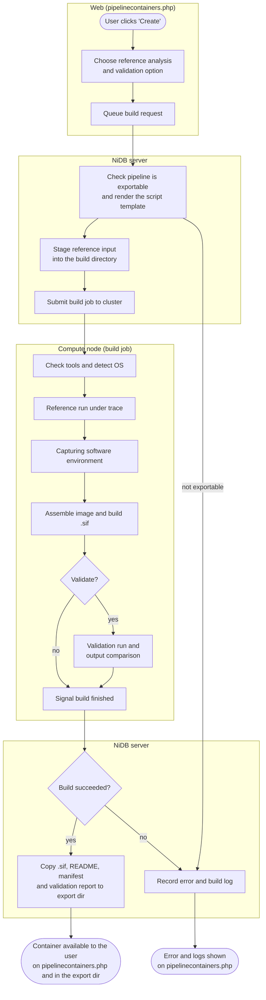

# Exporting a pipeline as an Apptainer container

Design notes for exporting a NiDB pipeline as a standalone Apptainer (`.sif`) image that anyone can run without NiDB. Written 2026-10-05, decisions in §11. **Status (2026-10-13):** the web UI (`pipelinecontainers.php`) and the `pipeline_containers` table are implemented. The backend (`modulePipelineContainer`) is partly implemented: see §9.

Companion docs: `doc/pipeline-execution.md` (how a pipeline runs today), `doc/analysis-api.md` (the check-in API that the container will *not* use).

---

## 1. Goal

The container is a portable version of an established level-1 pipeline, for people who don't have NiDB. One version of a pipeline (a row in `pipelines` plus its `pipeline_steps` and `pipeline_data_def` rows) becomes one generic image, which is run once per subject/study:

```
apptainer run --bind /data/sub01:/input --bind /results/sub01:/output mypipeline-v3.sif \
    --subjectuid S1234ABC --studynum 2 --studydatetime "2024-03-01 10:15:00"
```

The image contains four things:

| Item | Path in image | Notes |
|---|---|---|
| Input directory | `/input` | Empty mount point. The caller binds their data here; no data is baked into the image. See §6 for the expected layout. |
| Main script | `/pipeline/run.sh` + `/pipeline/run.sh.template` | The pipeline's main script steps, rendered from the NiDB definition. See §3–§4. |
| Software | same paths as on the compute node (`/opt/fsl`, `/usr/bin/R`, ...) | Captured from the compute node where the pipeline runs today. See §7. |
| Output directory | `/output` | Empty mount point. The caller binds a writable directory here. |

Plus a small, non-executed `/pipeline/manifest.json` (§6) describing the pipeline, variables, and input layout, so the image documents itself.

**Not in the image:** `nidb cluster` check-ins, `nidbapi`, step log redirection, supplement steps, the result script, the `useTmpDir` copy, `chmod 777`, scheduler headers, the API token, or anything else that is NiDB-specific or talks to the NiDB database or web server.

Only level-1 (subject/study level) pipelines can be exported. Export refuses level-0 (deprecated) and level-2 (group) pipelines.

---

## 2. What changes compared to the NiDB job file

`CreateClusterJobFile()` (`modulePipeline.cpp:2072`) builds the job script. The container script keeps only the main step commands and drops everything else:

| Job file element | Container |
|---|---|
| `#SBATCH` / `#$` headers, `LD_LIBRARY_PATH` | Dropped. The caller schedules the container however they like. |
| `NIDB_*` exports, `nidbapi()` function | Dropped |
| `nidb cluster -u pipelinecheckin ...` lines | Dropped |
| `cd <analysispath>` | `cd /output` |
| `useTmpDir` copy in/out | Dropped. The caller can bind a scratch directory as `/output` if they want local disk. |
| Step check-in + `echo Running ...` | Replaced with a plain `echo '== Step N: <description>'` to stdout. The description is shell-quoted, with flags removed and newlines flattened. |
| `{NOLOG}`, `{NOCHECKIN}`, `{PROFILE}` flags | Stripped from the command and description. `PROFILE` is not honored, and an enabled step that uses it gets a warning. |
| `>> <analysispath>/pipeline/StepN` log redirect | Dropped. Output goes to the container's stdout/stderr. |
| `cd <workingdir>` | Kept, after its variables are rendered (see §4 note about `workingdir`) |
| Disabled steps (`# command`) | Kept as comments, so the script still matches the NiDB step numbering |
| Supplement steps | Not exported. Supplements exist to augment an existing NiDB analysis during testing; the container runs a finished pipeline once. |
| Result script (`pipeline_resultsscript`) | Dropped. It exists to insert results into NiDB. |
| `updateanalysis` / `setcomplete` / final `chmod` | Dropped |

### In-place working directory

NiDB pipelines run *inside* the analysis directory: the data is downloaded into `<analysisroot>`, and steps write their outputs next to it, referring to everything as `{analysisrootdir}/...`. Existing scripts depend on that, so the container keeps the same model:

1. `run.sh` copies `/input/.` to `/output/` (`cp -a`).
2. `cd /output`.
3. `{analysisrootdir}` is `/output`.

So `/output` ends up looking like a NiDB analysis directory after the pipeline has run.

---

## 3. Pipeline variables

These are all the substitutions `FormatCommand()` (`modulePipeline.cpp:2008`) performs today, and what each becomes in the container.

**Export time** means NiDB replaces the token while building the image. **Runtime** means `run.sh` replaces it at startup.

| Variable | NiDB value | Container treatment |
|---|---|---|
| `{analysisrootdir}` | `<analysisroot>/...` path on shared storage | **Runtime:** always `/output` in the container. Kept as a token in the template (not baked in) so the build's trace run (§7) can render the same template to a scratch directory on the compute node. |
| `{pipelinename}` | `pipelines.pipeline_name` | **Export time:** constant |
| `{workingdir}` | The step's `ps_workingdir` | **Export time:** that step's working directory, rendered |
| `{description}` | The step's `ps_description` | **Export time:** constant, per step |
| `{subjectuid}` | Subject UID | **Runtime:** `--subjectuid` (required if used) |
| `{studynum}` | Study number | **Runtime:** `--studynum` (required if used) |
| `{uidstudynum}` | UID + studynum, concatenated | Converted to `{subjectuid}{studynum}` at export |
| `{studydatetime}` | `yyyy-MM-dd hh:mm:ss` | **Runtime:** `--studydatetime` (required if used) |
| `{analysisid}` | `analysis.analysis_id` | Not meaningful without NiDB, and not a runtime parameter. **Export time:** replaced with `0`, with a warning. `0` rather than an empty string, so a path like `/tmp/{analysisid}` can't collapse to `/tmp/`. |
| `{groups}`, `{uidstudynums}`, `{uidstudynums_<group>}`, `{numsubjects}`, `{numsubjects_<group>}` | Group-level, from live DB queries | Only meaningful for level-2 pipelines, which can't be exported. If one appears in a level-1 pipeline, export fails with an error naming the step. |
| `{NOLOG}`, `{NOCHECKIN}`, `{PROFILE}` | Flags | **Export time:** removed |
| `{command}` | Deprecated. Removed from the command by `FormatCommand()`, and flagged as a warning in the pipeline checks | **Export time:** removed, with a warning |
| `{first_*_file}` etc. | Already deprecated, not expanded | **Export time:** error |

So an exported pipeline needs at most three runtime values: `subjectuid`, `studynum`, `studydatetime`. The manifest records which ones the script uses, and `run.sh` only requires those.

Any other `{...}` token left after export is an error. This catches typos that NiDB silently leaves alone today.

---

## 4. How the substitution works

### Text rendering at startup (same semantics as NiDB)

The image stores `run.sh.template`, with the runtime tokens still in their `{...}` form. At startup, `run.sh` replaces them with the argument values, writes the result to a temporary file, and runs it with `bash`. This is what NiDB does today (plain text replacement before bash ever sees the script), so a command behaves identically in both places, including inside single quotes, quoted heredocs, `awk` programs, and generated filenames.

### Details

- **Case.** `FormatCommand()` matches case-insensitively (`{SubjectUID}` works). At export, NiDB rewrites every recognized token to lowercase with a `QRegularExpression::CaseInsensitiveOption` pass. That way the bash renderer only needs exact matches.
- **Substitution in bash.** `run.sh` uses `line=${line//"{subjectuid}"/$SUBJECTUID}`, with the pattern quoted. bash 5.2 has `patsub_replacement` enabled by default, where `&` in the replacement means "the matched text," so `run.sh` turns it off with `shopt -u patsub_replacement` (bash 4.2 doesn't have the option, and the `shopt` error is discarded). The validated values can't contain `&` anyway. The replacement is a plain variable in an assignment, so it isn't word-split or globbed.
- **Validation (required).** Rendered values become shell code, so `run.sh` must reject bad input before it renders anything:
  - `subjectuid` must match `^[A-Za-z0-9_-]+$`;
  - `studynum` must match `^[0-9]+$`;
  - `studydatetime` must match `^[0-9]{4}-[0-9]{2}-[0-9]{2} [0-9]{2}:[0-9]{2}:[0-9]{2}$`.

  In NiDB these values come from the database. In the container they come from whoever runs it.
- **Error handling.** The NiDB job file doesn't use `set -e`: a failing step doesn't stop later steps. The container keeps that by default, so results match, and `--stop-on-error` turns on `set -e`. `run.sh` exits with the status of the last step.
- **`workingdir`.** NiDB writes `cd <workingdir>` *without* passing it through `FormatCommand()` (`modulePipeline.cpp:2284`), so a working directory of `{analysisrootdir}/fsl` currently `cd`s to a literal `{analysisrootdir}/fsl`. Export should render it. This is also worth fixing in the NiDB job file itself.

### Example

Pipeline step 2 in NiDB:

```
cd {analysisrootdir}; bet T1/{SubjectUID}_t1.nii.gz T1/brain {NOLOG}   # Skull strip
```

`run.sh.template` after export:

```bash
# Step 2: Skull strip
echo '== Step 2: Skull strip'
cd {analysisrootdir}; bet T1/{subjectuid}_t1.nii.gz T1/brain
```

`RenderScriptTemplate()` writes each enabled step as the comment, the echo, `cd <workingdir>` (if the step has one) and the command, with a trailing `;` removed as `FormatCommand()` does. A disabled step is written as a `# Step N (disabled):` comment followed by its commented-out lines. Variables are replaced in one pass over the text, so values inserted for `{workingdir}` and `{description}` aren't scanned again. After rendering, any `{word}` other than the four runtime tokens in a line that runs is an error. `requiredVariables` lists the runtime variables that appear in the lines that run, and is written to `manifest.json` and `requiredvars.txt` (one per line).

Rendered at runtime with `--subjectuid S1234ABC`:

```bash
cd /output; bet T1/S1234ABC_t1.nii.gz T1/brain
```

### `run.sh` (fixed, same for every pipeline)

```
usage: run.sh [--subjectuid UID] [--studynum N] [--studydatetime "YYYY-MM-DD hh:mm:ss"] [--stop-on-error] [--help]
```

1. Parse the arguments, and check them against the validation rules above.
2. Check that every variable in `/pipeline/requiredvars.txt` was given.
3. Check that `/output` exists and is writable. Its path becomes `{analysisrootdir}` and is inserted as text, so it may only contain letters, numbers and `_ . + / -`.
4. If `/input` isn't empty, `cp -a /input/. /output/`.
5. Render `/pipeline/run.sh.template` into a `mktemp` file in `$TMPDIR` (default `/tmp`), deleted on exit. A variable that wasn't given is left as it is; since `requiredvars.txt` covers every line that runs, those can only be in comments and echo lines.
6. `cd /output` and run the rendered script with `bash` (`bash -e` with `--stop-on-error`), then exit with its status.

`--help` prints the usage and `/pipeline/README.txt`. `run.sh`'s own errors exit with status 2.

`run.sh` is the same for every image, so the per-pipeline output is only the template and the manifest. It's embedded in `modulePipelineContainer.cpp` and written into the build directory by `WriteRunScript()`, like `build-container.sh`, so there's no extra file to install with NiDB. It must work with bash 4.2 (CentOS 7) and avoid tools that may be missing from a minimal base image (no `jq`: the build writes `requiredVariables` into a plain-text file next to the manifest). For the reference run (§7 step 1), which runs `run.sh` on the node outside a container, `run.sh` reads `NIDB_PIPELINE_DIR`, `NIDB_INPUT_DIR` and `NIDB_OUTPUT_DIR` in place of `/pipeline`, `/input` and `/output`. `NIDB_*` variables are never copied into the image's environment.

---

## 5. Absolute paths in step commands

Step commands often contain absolute paths. Most are handled automatically by the trace (§7), which captures whatever the pipeline touched. Two kinds are checked at export, before anything runs:

| Kind | Example | Handling |
|---|---|---|
| The pipeline's own analysis root | `/nidb/data/analysis/S1234ABC/2/mypipe/...` written literally instead of `{analysisrootdir}` | Error: the user must change the step to use `{analysisrootdir}` |
| NiDB archive or other pipelines' analysis dirs | `/nidb/data/archive/...` | Error: data has to come in through `/input` |

Detection compares path-like tokens in the commands against `cfg[archivedir]`, `cfg[analysisdir]`, `cfg[analysisdirb]`, and the `analysisdirs` table.

---

## 6. Input layout and the manifest

The container doesn't download data. The caller has to provide `/input` laid out the way `GetData()` would have staged it (`doc/pipeline-execution.md` §6):

- per enabled data step: `<pdd_location>/[<seriesnum>/][<phasedir>/]` holding files in `pdd_dataformat` (`dicom`, `nifti3d`, `nifti4d`, ... gzipped if `pdd_gzip`). `<seriesnum>` is the original series number if `pdd_preserveseries`, otherwise 1, 2, 3, ...; `<phasedir>` is `AP`, `PA`, `RL`, `LR`, `COL`, `ROW` or `unknownPE`;
- behavioral data, as `GetBehPath()` places it: `behroot` → `<location>`, `behrootdir` → `<location>/<behdir>`, `behseries` → `<location>/<seriesnum>`, `behseriesdir` → `<location>/<seriesnum>/<behdir>`;
- or, if `pipeline_outputbids` is set, a BIDS dataset in `<BIDSoutputDir>`, with `sub-<subjectuid>/ses-<studynum>` directories;
- if the pipeline has a parent: the parent pipeline's output in `/input/<parent pipeline name>/` (`pipeline_dependencydir` = `subdir`) or the root.

The layout is documented, not enforced or converted. The container doesn't check `/input` or rearrange data; matching the layout is the caller's job. `modulePipelineContainer::GetInputDirStructure()` generates the description from the pipeline version's data steps (`modulePipeline::GetPipelineDataDef()`), as readable text and as JSON, and it's published in four places:
- `README.txt`, in the export directory next to the `.sif`, and in the image as `/pipeline/README.txt`;
- the image's `%help`, which is `README.txt`, so `apptainer run-help <sif>` shows it;
- `manifest.json` `inputLayout`: one object per entry, with `type` (`data`, `bids` or `parent`), `location`, and for data steps `modality`, `protocol`, `format`, `gzip`, `seriesDirectories`, `preserveSeriesNumbers`, `phaseDirectories`, `behavioralLocation`, `behavioralOnly`, `optional`;
- the Usage section of `pipelinecontainers.php`, which uses the same rules for the current version.

Example `README.txt` section:

```
INPUT LAYOUT (/input)
Lay out /input as NiDB would have staged the data for this pipeline. The container doesn't check the layout.

    /input/T1/<seriesnum>
        MR, protocol [MPRAGE], format [nifti3d, gzipped]
        <seriesnum> is 1, 2, 3, ... for each matching series, in order
    /input/fmri/<seriesnum>
        MR, protocol [rest], format [nifti4d, gzipped]
        <seriesnum> is the series' original series number
        Optional
```

`/pipeline/manifest.json` records:
- this input layout;
- the pipeline name, version, description, and the date and NiDB instance it was exported from;
- `requiredVariables`;
- the base OS and the captured software (system packages with versions, `/opt` directories, other paths), from §7;
- any export warnings;
- the full squirrel pipeline JSON, reused from `pipeline::GetSquirrelObject()`, so the image can be re-imported into a NiDB instance later.

`README.txt` (written by `CreateReadme()`) has the pipeline name, version and description, an example `apptainer run` command, the arguments this pipeline uses (§3), and the input layout. It's the image's `%help`, so `apptainer run-help` shows the same text, and it's copied next to the `.sif` in the export directory (§8).

---

## 7. Capturing the software

Real pipelines use whatever is on the compute node: software in `/opt` installed by the sysadmin, and system software (R, perl, python, tcsh, their libraries and add-on packages) from the node's OS. NiDB has no record of which. So the build runs on a compute node where the pipeline runs today, and finds out by running the pipeline once. Discovery and build happen in one job on a compute node, in the pipeline's own queue.

### Step 1: a reference run under `strace`

The export is based on a **reference analysis**: a completed, not-bad analysis of this pipeline version, picked by the user (default: the most recent one).
- NiDB stages that study's input again into `<builddir>/input` with `StageReferenceInput()`:
  - **Data steps:** `modulePipeline::GetData()`, with the requested version's data steps, called with analysis ID `-1` so it doesn't log events or set the status on any analysis, and with `localCopy`, so it copies with `cp` even if the pipeline uses `scp`. Its data log goes to `input.log`. As in `modulePipeline`, staging fails if no series were found, unless the pipeline has a study-level parent.
  - **Parent pipeline:** the first parent, as in `modulePipeline`. A study-level parent's analysis of the same study, or a subject-level parent's completed analysis nearest in time. Its directory comes from `GetAnalysisLocalPath()` with the parent's own directory structure. It's copied with `cp -au` (always a regular copy, whatever the link type) into `input/` or `input/<parent name>/`, and the parent's `pipeline/` logs, `origfiles.log`, `sge.job` and `slurm.job` are removed.
  - `GetData()` reads the pipeline's BIDS settings from the current version, not the requested one.
- The build job renders `run.sh.template` with the reference study's values and `{analysisrootdir}` set to a scratch directory, and runs it under `strace -f -e trace=file,process -o trace.log`.
- It runs in a login shell, like the pipeline job (`#!/bin/bash -l`), and dumps the environment (`env`) at the start.

This runs the pipeline once on a compute node, which takes as long as the pipeline (many hours for FreeSurfer).

### Step 2: sort what was touched

Every existing file opened or executed, outside the scratch directory and `/proc`, `/sys`, `/dev`, `/tmp`, is sorted:

| Kind | How it's found | What gets copied |
|---|---|---|
| Owned by a system package (`/usr/bin/R`, `libgomp.so.1`, perl modules from the distro) | The node's package manager: `rpm -qf <file>` (RHEL family, SUSE, Fedora) or `dpkg -S <file>` (Debian, Ubuntu) | The whole package (`rpm -ql` / `dpkg -L`), at the node's installed version. Copying the whole package covers files the reference run didn't happen to touch, and pins the exact versions without needing a working package repo. |
| Under `/opt/<name>` | path | The whole `/opt/<name>` directory |
| Language add-on libraries not owned by a package (R site library, CPAN modules, python packages installed under `/usr/local`) | path matches a known library root for the OS family (§7 "Supported OSes") | That whole library root, so any add-on package the script loads conditionally is included |
| Other unowned files (`/usr/local/bin/foo`, user scripts in `/home/...`) | everything else | The file. For a script directory named in the step commands, the whole directory. |

If the node has neither `rpm` nor `dpkg` (or the package database is unusable), everything is treated as an unowned file. The image then gets what the trace and the `ldd` pass found. That still works, but it's less complete, and the export log says so.

Then:
- a `ldd` pass over every copied ELF file adds any shared library the trace missed (resolved again through the package manager);
- **environment:** variables from the login environment that point into copied paths, or are known tool settings (`PATH`, `LD_LIBRARY_PATH`, `*DIR`, `*_HOME`, `FSLOUTPUTTYPE`, `R_LIBS*`, `PERL5LIB`, ...) go into the image's environment. Scheduler, user, and NiDB variables (`SLURM_*`, `SGE_*`, `NIDB_*`, `HOME`, `USER`, `SSH_*`) don't. Apptainer doesn't source `/etc/profile.d` from the image, so this is needed even when the `profile.d` files are copied.
- **deny list, never copied even if touched:** `/etc/shadow`, `/etc/gshadow`, `/etc/munge/`, `/etc/ssh/*_key`, `*.keytab`, `/etc/sssd/`, `~/.ssh/`, `nidb.cfg`, and known license files (FreeSurfer `license.txt`, MATLAB `licenses/`). Excluded files are listed in the export log. FreeSurfer's license must then be bound at runtime (`--bind license.txt:/opt/freesurfer/license.txt`).

A trace only sees the code path that the reference run took. Whole-package and whole-directory copies cover most of the gap. For the rest, the pipeline's container settings (not yet implemented) allow extra paths to include and paths to exclude, saved per pipeline version and applied on every export.

### Step 3: base image

The feature is neutral about the cluster OS: any Linux distribution should work. The base is the same OS release as the compute node, read from `ID` and `VERSION_ID` in `/etc/os-release` and looked up in a mapping table in `build-container.sh` (e.g. `centos 7` → `docker://centos:7.9.2009`, `rocky 8` → `docker://rockylinux:8`, `ubuntu 22.04` → `docker://ubuntu:22.04`). The captured package files are laid over it, so the image ends up with the node's versions of everything the pipeline uses, and the base's own (possibly older) versions of everything else. No package manager runs during the build, so no repos are needed.

If the node's OS isn't in the mapping table, the build stops with an error, unless the pipeline's container settings name a base image explicitly. That override is also how to use a pre-pulled `.sif` on shared storage.

### Supported OSes

The design is distribution-neutral, but each OS family needs a few facts. A family counts as **supported** once a real pipeline has been exported from it and the image has run successfully on a different machine. The facts per family:
- package manager commands;
- base image name pattern;
- language library roots.

| OS family | Package manager | Base image | Language library roots (unowned add-ons) | Status |
|---|---|---|---|---|
| RHEL family: CentOS 7, Rocky/Alma 8–9, RHEL | `rpm -qf` / `rpm -ql` | `centos:7.9.2009`, `rockylinux:<N>`, `almalinux:<N>` (RHEL nodes: Rocky/Alma of the same major version, since the RHEL UBI images are incomplete) | `/usr/lib64/R/library`, `/usr/local/lib64/R/library`, `/usr/local/share/perl5`, `/usr/local/lib64/perl5`, `/usr/local/lib/python*/site-packages`, `/usr/local/lib64/python*/site-packages` | Untested |
| Debian / Ubuntu | `dpkg -S` / `dpkg -L` | `debian:<N>`, `ubuntu:<N>` | `/usr/local/lib/R/site-library`, `/usr/lib/R/site-library`, `/usr/local/share/perl/*`, `/usr/local/lib/x86_64-linux-gnu/perl/*`, `/usr/local/lib/python*/dist-packages` | Untested |
| SUSE (openSUSE Leap, SLES) | `rpm -qf` / `rpm -ql` | `opensuse/leap:<N>` | as RHEL family | Untested |
| Anything else | none (trace + `ldd` only) | explicit override required | none | Not supported, but may work |

The library roots are a starting point. `R_LIBS*`, `PERL5LIB` and `PYTHONPATH` from the node's login environment are added to them automatically. This table should be updated as each OS is tested, and a copy of the supported list goes into the user documentation.

### End-of-life OS images

Preserving pipelines on the OS they were built and validated on is a goal of this feature. CentOS 7 is used as the example below, but the same applies to any old release (Ubuntu 16.04/18.04, Debian 9, ...). A typical case is a pipeline that runs on CentOS 7 nodes, which will eventually be upgraded or retired. This works because only the host kernel and Apptainer itself matter at runtime, and an EL9 kernel runs a CentOS 7 userspace.

- **Export while the old nodes still exist.** Because the software is captured from the node, a CentOS 7 pipeline must be exported from a CentOS 7 node. Once the nodes are upgraded, the node's R, perl and system libraries for that pipeline are gone. Recovery then means rebuilding from the CentOS 7 archive repos (`vault.centos.org`), with `%post` package installs. That needs `--fakeroot` builds, and it doesn't reproduce the node's package versions.
- **Dead repos don't matter for the normal path.** `docker://centos:7.9.2009` can still be pulled, and since the build copies package files rather than installing them, the defunct `mirrorlist.centos.org` isn't used. Only the fallback above, or extra `%post` installs, needs the repos repointed at the vault and `ca-certificates` updated first.
- **glibc check.** CentOS 7 has glibc 2.17. Old binaries run on newer glibc, but not the reverse. Before building, the job checks the copied `/opt` and other non-package binaries with `objdump -T`. It warns about any that need a newer glibc than the base has, which happens when `/opt` holds software that was built on a newer system.
- **No security updates.** The image carries known, unpatched CVEs. For a batch container with no network services the practical risk is low, but institutional scanners and some HPC centers may flag or block such images. The export writes a warning into the export log, `README.txt` and `manifest.json`.
- **How old.** CentOS 7–era userspaces run on current kernels. CentOS 6 and older can hit kernel incompatibilities (e.g. the vsyscall issue) and are not a target.

### Size, licensing, and portability

- **Size.** `/opt/fsl` is ~5 GB and FreeSurfer ~10 GB, so images will be large. squashfs compression helps, and the export reports the image size.
- **Licensing.** Commercial software (MATLAB, ...) must not end up in an image meant to be shared. Beyond the license-file deny list, the export warns when it copies a known commercial install directory. Compiled MATLAB with the MCR can be included.
- **GPU / MPI.** Out of scope for a first version. `--nv` works at runtime if the software supports it.

---

## 8. Build process



1. **Trigger.** The **Create** button on `pipelinecontainers.php` (reached from the *Manage containers* tile on the pipeline's Operations tab) always builds the pipeline's current version. It's only enabled for the pipeline owner or a site admin, and only when the export checks shown on that page have no errors (level-1 pipeline, at least one completed, not-bad analysis of this version, no group/deprecated variables or NiDB storage paths in the steps; see "Web UI" below), and when no build for this version is already in progress. The user picks the reference analysis (default: the most recent) and whether to run the validation step (on by default; turning it off is useful for long pipelines). A row then goes into `pipeline_containers` with `build_status` = `submitted`, `build_createdate` = now, `reference_analysisid` and `run_validation`.
2. **Prepare (NiDB server).** The `pipelinecontainer` module (`modulePipelineContainer`, run every minute from cron like the other modules) picks up `submitted` rows and sets them to `started`. A row still `started` when the module next runs means a previous run stopped part way through, and is marked `error`. The module writes a build directory on shared storage that both the server and the compute nodes can reach, `cfg[analysisdir]/_apptainer/<pipelinecontainer_id>/` (named by ID only, so it can be found from the row alone and doesn't change if the pipeline is renamed), containing:
   - `run.sh` (fixed), `run.sh.template`, `manifest.json` (partial), `README.txt`, `requiredvars.txt`;
   - the build directory is removed first if it's left from an earlier attempt, since an old `build.exitcode` would make the build look finished;
   - `input/`: the reference study's input, staged again (§7 step 1), and `input.log`, the data log;
   - `export.log`: the pipeline, version, reference analysis, required arguments and the export warnings (§3, §5). Errors stop the export before this point;
   - `build-container.sh`, written by `WriteContainerBuildScript()` (see "The build script" below), then `build.job`, written by `WriteClusterJob()`: the sbatch/SGE header from the pipeline's cluster settings, then `exec /bin/bash -l build-container.sh` (no arguments; all settings are in the script). The header matches `modulePipeline`'s job files, except:
     - the job name is `<pipeline>-container`, and the scheduler output goes to the build directory;
     - the wall time is the pipeline's maximum × the number of pipeline runs (1, or 2 with validation) + 4 hours, for the capture and image build. No limit if the pipeline has none;
     - SGE jobs don't use `-V`, so the submit host's environment doesn't end up in `env.txt` and the image.
3. **Submit** `build.job` with the existing `nidb::SubmitClusterJob()`, using the pipeline's own cluster and queue settings, and set `build_status` = `building` and `build_startdate`.
4. **Build (compute node)**, done by `build-container.sh`:
   1. Check that the required tools are present, and fail with a message listing any that are missing. Read `/etc/os-release`, choose the base, and choose the package manager (§7 step 3).
   2. Reference run under `strace`, plus the environment dump (§7 step 1).
   3. Sort and collect the files into a staging tree, with the `ldd` pass, deny list and glibc check (§7 step 2).
   4. `apptainer build --sandbox base/ docker://<base>`, then copy the staging tree and `/pipeline/*` into `base/`.
   5. Build the `.sif` from a definition file with `Bootstrap: localimage` / `From: base/` and only `%environment`, `%runscript`, `%labels` and `%help` (no `%post`).
   6. **Validation run (optional):** `apptainer run` the new image on `input/` and compare the output file list with the reference analysis directory. NiDB's `pipeline/` logs, job files and the `completeFiles` check are excluded from the comparison. The results go to `validation.txt`.
   7. Write `build.exitcode`.
5. **Finish (NiDB server).** The module polls for `build.exitcode`. On success it copies `<pipeline>-v<version>.sif`, `README.txt`, `manifest.json` and `validation.txt` to `cfg[exportdir]/NiDB-Apptainer-<pipeline>-v<version>/`. It records `build_status` (`complete` or `error`), `build_enddate`, `container_path`, `container_date` (when the copy to `cfg[exportdir]` finished and the container became available), `container_size` and `container_sha256`, the export warnings (§3, §5, §7) in `build_warnings`, and the build log (including the validation summary) in `build_log`, then deletes the build directory. Polling means the build job needs no NiDB connection, check-ins or token.

Only `build-container.sh` runs on the node. It doesn't depend on the `nidb` binary on the cluster. It needs only:
- standard Linux tools: `bash`, coreutils, `find`, `ldd`;
- the node's package manager, if there is one;
- `strace`, `objdump` (binutils) and `apptainer`, installed on the nodes for this feature (§8 "Cluster requirements").

### The build script (`build-container.sh`)

A bash script, generated per build. `modulePipelineContainer::WriteContainerBuildScript()` writes it into the build directory during step 2, before `build.job`. It has two parts:
- **Settings block, generated per build:** container ID, pipeline name and version, the build directory and reference analysis directory as the compute node sees them (`cfg[clusteranalysisdir]`; `GetAnalysisClusterPath()`), the reference study's UID, study number and date (checked against `run.sh`'s rules before writing), `RUN_VALIDATION`, the `.sif` name, and a base image override (empty until the container settings exist). Values are shell-quoted.
- **Body, the same for every build:** stored as a raw string in `modulePipelineContainer.cpp`.

The script collects but doesn't parse. It writes plain text files (`key=value` or one item per line) into the build directory, and `Finish()` on the NiDB server reads them with Qt to build `manifest.json` and update the `pipeline_containers` row. JSON is never written from bash.

| File | Contents |
|---|---|
| `build.log` | Everything the script prints, with timestamps |
| `build-warnings.txt` | One warning per line; added to `build_warnings` |
| `build-error.txt` | Why the build stopped, if it did |
| `sysinfo.txt` | `key=value`: host, job ID, kernel, arch, `os-release` values, OS family, package manager, base image, glibc, bash, apptainer, strace and objdump versions, CPUs, memory, `ptrace_scope`, free scratch and build-dir space |
| `software.txt` | `key=value`: paths and versions of R, Rscript, perl, python, python3, java (paths only for tcsh, csh, matlab, octave), package count |
| `env.txt` | The login environment, dumped before the script changes anything |
| `packages.txt` | Installed packages: name, version-release, arch (tab separated). Empty with no package manager |
| `modules.txt` | `module list` output, if environment modules are set up |
| `opt.txt` | The entries in `/opt` |
| `trace.log`, `reference-run.log` | strace output and output of the reference run |
| `container.def` | The generated definition file |
| `validation.txt` | `key=value` summary (`exitcode`, `reference_files`, `container_files`, `missing_files`, `extra_files`), then `[missing]` and `[extra]` file lists |
| `<pipeline>-v<version>.sif` | The container |
| `build.exitcode` | `0` on success. Always written last, atomically (temp file + `mv`), from an `EXIT` trap that also fires on `SIGTERM` from the scheduler |

Stages, in order: dump the environment; find tools; detect the OS, family, package manager and base image; write `sysinfo.txt` and `software.txt`; stop if a tool is missing or there's no base image (so the info is still collected for diagnosis); reference run under `strace -f -s 4096 -e trace=file,process`; capture the software (**not implemented yet**: the script stops here with an error); build the sandbox and `.sif`; validation run, if chosen. The script uses `set -u` but not `set -e`, so a failing info command doesn't stop the build; each stage checks the commands that matter and calls `fail`. A non-zero exit from the reference or validation run is a warning, not an error, since a pipeline's last step can fail without the pipeline being broken.

Tested so far on AlmaLinux 9 up to the software capture stage, with a stand-in `apptainer`. Not yet tested on a real node or with bash 4.2.

### `pipeline_containers` table

| Column | Type | Set by | Meaning |
|---|---|---|---|
| `pipelinecontainer_id` | int, auto increment | | Primary key |
| `pipeline_id`, `pipeline_version` | int | Web | The pipeline version the container is built from (always the current version when created) |
| `build_status` | enum `submitted` / `started` / `building` / `complete` / `error` | Web, then module | `submitted` by the web page; `started` when the module picks it up (step 2); `building` once the job is submitted (step 3); `complete` or `error` at the end (step 5) |
| `reference_analysisid` | int | Web | The completed analysis whose study is re-run under trace (§7 step 1) |
| `run_validation` | tinyint | Web | Whether to run the validation step (step 4.6) |
| `build_createdate` | datetime | Web | When the user clicked Create |
| `build_startdate`, `build_enddate` | datetime | Module | Build job submitted / build finished |
| `build_warnings` | text | Module | Export warnings (§3, §5, §7: `{analysisid}`, excluded deny-list files, glibc, commercial software, EOL OS, ...) |
| `build_log` | text | Module | Export and build log, including the validation summary |
| `container_path` | text | Module | Path of the final `.sif` in `cfg[exportdir]` |
| `container_size` | bigint | Module | Size of the `.sif` in bytes |
| `container_sha256` | varchar | Module | sha256 of the `.sif` |
| `container_date` | datetime | Module | When the `.sif` was copied to `cfg[exportdir]` and became available. Only set on success |

The base image and Apptainer version are in the image's `%labels`, `manifest.json` and `build_log`. The full validation report is `validation.txt` in the export directory.

### Web UI (`pipelinecontainers.php`, implemented)

Opened from the *Manage containers* tile on the pipeline's Operations tab (`pipelinecontainers.php?id=<pipeline_id>`). It shows:
- **In progress:** `submitted` / `started` / `building` rows.
- **Containers:** `complete` / `error` rows, with version, reference analysis, validation, submitted / build started / build finished / available dates, path, size, sha256, and the warnings and log.
- **Usage:** an example `apptainer run` command with only the arguments this pipeline's script uses (§3), and the expected `/input` layout from the enabled data items, BIDS setting and dependency (§6).
- **Create container:** the export checks for this pipeline as a list of pitfalls, then the reference-analysis picker, the validation checkbox and **Create**. Errors (level ≠ 1, no enabled steps, no completed analysis, group, deprecated `{first_*}` or unrecognized variables, NiDB storage paths in the steps) disable Create, and are checked again on submit. Warnings: `{analysisid}`, `{command}`, a parent dependency, FreeSurfer license, MATLAB, and a long average runtime. Only enabled main steps are checked, since only they run in the container. Info: supplement steps, results script and temp dir not exported, FSL size, untaken code paths, compute node OS. These are a web-side preview. The backend checks are authoritative: `modulePipelineContainer::CheckIfExportable()` (with `CheckVariables()` and `CheckPaths()`) applies the same errors and warnings, except the long-runtime warning and the info items, and `WriteContainerBuildScript()` checks that the chosen reference analysis is complete and not bad.

### Example generated definition file (step 4.5)

```
Bootstrap: localimage
From: <builddir>/base

%environment
    export FSLDIR=/opt/fsl
    export PATH=/opt/fsl/bin:/usr/local/bin:/usr/bin:/bin
    export FSLOUTPUTTYPE=NIFTI_GZ
    export R_LIBS_SITE=/usr/local/lib64/R/site-library

%runscript
    exec /pipeline/run.sh "$@"

%labels
    org.nidb.pipeline.name mypipeline
    org.nidb.pipeline.version 3
    org.nidb.base docker://centos:7.9.2009
    org.nidb.buildos CentOS Linux 7 (Core)
    org.nidb.exported 2026-10-06

%help
    (README.txt, indented)
```

Software doesn't appear in the definition file, because it was copied into the sandbox in step 4.4.

### Cluster requirements (check first)

- Apptainer, `strace` and binutils (`objdump`) installed on the compute nodes. These aren't always present by default, but can be installed. Tracing the job's own child processes is allowed under the default `kernel.yama.ptrace_scope = 1`.
- Unprivileged builds: pulling a sandbox from `docker://` and building a `.sif` from a sandbox both work without root. Whether step 4.5 (a definition file with no `%post`) needs `--fakeroot` depends on the Apptainer version, so this needs testing on the cluster.
- Outbound network access from the node to pull the base image, or a pre-pulled base `.sif` on shared storage.
- Node-local scratch for the build (`APPTAINER_TMPDIR`) and room for the reference run.

---

## 9. Code changes

| Area | Change |
|---|---|
| `modulePipeline.cpp` | Split the step-rendering part of `CreateClusterJobFile()` into a function used by both the job file and the container export, so both always agree on step order, enabled/supplement handling, and flags. Add an export-mode variable pass (§3) next to `FormatCommand()`. **Done:** `GetData()` takes a `localCopy` flag, to always copy with `cp`; with analysis ID `-1` it already logs nothing. The dependency copy is reimplemented in `StageReferenceInput()`, since in `modulePipeline` it's inline in the main loop. |
| New `modulePipelineContainer.{h,cpp}` | **Skeleton done:** the `pipelinecontainer` module, with the status flow (`submitted` → `started` → `building` → `complete`/`error`), row claiming, and `build_log`/`build_warnings` helpers; the stage functions are stubs. Run with `nidb pipelinecontainer [--containerid N]`; `--containerid` processes only that row. Registered in `main.cpp`, `nidb.cpp` (1 thread), `nidb.pro`, the `modules` table seed (`nidb-data.sql`, inactive by default) and `crontab.txt`. **Done:** `build-container.sh` and `build.job` writing, `README.txt` and the `manifest.json` input layout (§6). Export checks (`CheckIfExportable()`: level 1, enabled steps, completed analysis, variables and paths, §1, §3, §5). Template rendering (`RenderScriptTemplate()`), `run.sh` (`WriteRunScript()`), `requiredvars.txt`, `export.log`. `PrepareExport()` loads the requested pipeline version. Reference input staging (`StageReferenceInput()`, §7 step 1). The build directory is made writable for the cluster user (`chmod -R 777`, as for analysis directories). **To do:** the rest of the manifest, job submission, polling, copying to `cfg[exportdir]` |
| `run.sh` | Fixed runner script (§4), embedded in `modulePipelineContainer.cpp` and written by `WriteRunScript()`. **Done.** Tested with bash 5.1; not yet with bash 4.2. |
| `build-container.sh` | Build script for the compute node (§7, §8 step 4), generated per build by `modulePipelineContainer::WriteContainerBuildScript()` (§8 "The build script"). Holds the per-OS-family table (package manager, base image, library roots) from §7 "Supported OSes". **Done:** OS/tool detection, system and software info, reference run, sandbox and `.sif` build, validation; `build.job` (`WriteClusterJob()`). **To do:** software capture (§7 step 2). |
| `pipelines.php`, `pipelinecontainers.php` | **Done:** *Manage containers* tile on the Operations tab; `pipelinecontainers.php` with existing and in-progress containers, usage, export checks, and Create (reference analysis, validation). **To do:** container settings (extra include/exclude paths, base override) on `pipelines.php`. |
| SQL | `pipeline_containers` table (**done**, §8). Container settings columns on `pipelines` + `pipeline_options` (versioned like the other options). |
| `doc/` | This doc |

---

## 10. Effort estimate

| Phase | Work | Estimate |
|---|---|---|
| 1 | Step rendering refactor, export-time variable pass, level-1 and path checks, `run.sh` with validation, manifest | 1–1.5 weeks |
| 2 | ~~`GetData()` / dependency-copy refactor to stage the reference input into an arbitrary directory~~ (done) | — |
| 3 | `build-container.sh`: tool check, OS detection and per-family table, traced reference run, environment capture, file sorting with `rpm`/`dpkg`/no-package-manager handling, package/`/opt`/library-root copying, `ldd` pass, deny list, glibc check, sandbox and `.sif` build, optional validation run | 2–2.5 weeks |
| 4 | ~~`pipeline_containers` table, web UI~~ (done), build job submit, polling, copy to `cfg[exportdir]` | 1 week |
| — | Testing on 2–3 real pipelines on the local cluster's OS: build, run the image on another machine, and compare with NiDB's output. Elapsed time depends on how long the pipelines run. | 1 week |
| Ongoing | Testing each further OS family (§7 "Supported OSes"), one at a time as needed. Mostly elapsed time and small fixes to the per-family table. | 1–3 days per OS |
| Later | Fallback for pipelines whose nodes are already upgraded: archive repos plus `%post` installs with `--fakeroot` | 3–5 days |

That's ~6 weeks for a usable feature that's tested on one OS family. Automatic software capture (§7) is required, since real pipelines rely on the node's `/opt` and system software and no one maintains a list of it.

---

## 11. Decisions

- **Audience:** people without NiDB. The container is a portable version of an established, debugged pipeline, run once per subject/study. Nothing NiDB-specific goes inside.
- **Input:** `/input` is a mount point. No data is baked into the image.
- **Supplement steps:** not exported (§2).
- **Level:** only level-1 pipelines can be exported. Group variables in a level-1 pipeline are an export error (§3).
- **`{analysisid}`:** not a runtime parameter. Replaced with `0` at export, with a warning (§3).
- **Output location:** the finished `.sif` plus `README.txt`, `manifest.json` and `validation.txt` go to `cfg[exportdir]` (`/nidb/data/ftp`, the directory `moduleExport` already uses for FTP exports).
- **Build location:** a compute node where the pipeline runs today. Software is discovered there by a traced reference run (§7).
- **Software source:** the node's `/opt` and its system software (R, perl, ...), captured as whole system packages, whole `/opt/<name>` directories, and whole language library roots.
- **Cluster OS:** neutral; any Linux. The package manager and base image are detected per node. A list of tested ("supported") OS families is kept in §7 "Supported OSes".
- **Build tools:** Apptainer, `strace` and binutils will be installed on the compute nodes as needed.
- **Build directory:** under `cfg[analysisdir]`, which both the NiDB server and the nodes can reach.
- **Validation run:** optional, chosen at export; on by default.
- **Build script:** bash, generated per build (§8 "The build script").
- **Input layout:** documented in `README.txt`, `%help` and `manifest.json`; not checked or converted (§6).

